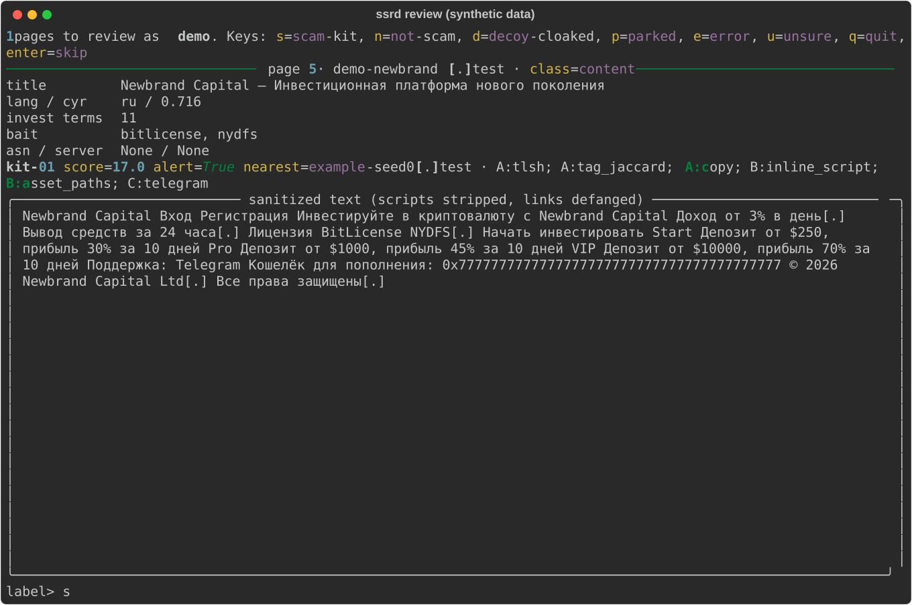

# SSRD: Scam-Site Respawn Detector

SSRD watches Certificate Transparency logs for newly certified domains and checks them against fingerprints of known fake crypto investment kits. The aim is to measure whether, and how fast, the operation behind the Brooklyn DA Virtual Currency Unit's Oct 2026 takedown rebuilds.

It reports honest numbers: precision with a 95% CI, backtest catch rate, time to flag and weekly volume.
A kit match means "same software", not "same people". The flagged-domain list and seed data are never published.

## Status (Oct 23 2026)

| Part | State |
|---|---|
| CT ingest (static-CT names tiles) | ✅ running in a hardened container on the local box |
| Seeds | ✅ Bank of Russia blacklist (52,966 domains, refreshed daily) · ✅ 13 KCDA seeds (banner-verified + VCU releases), with Wayback pre-seizure pages |
| Name filter | ✅ n-gram classifier: recall 0.55 at 0.71% pass rate (keywords: 0.44 at 1.19%) |
| Kit library | ✅ 54 multi-domain kits (incl. KCDA kits) + 306 single-site references · backtest **69% (38/55, CI 56-80%)** |
| Live alerts | 378 since Oct 17; 257 still alert under the Oct 21 rule (generic-script and placeholder false positives removed). Only 2 matched KCDA kits, and both look like false positives, so far no visible respawn of the seized network on new certificates. Most matches are CBR-listed kits, including one multilingual "AI analyst" funnel seen in 8+ languages within days. Every alert gets an assistant suggestion (rules first); awaiting the labeled samples |
| Automation | systemd user timers: hourly watchdog, daily CBR refresh + seed refresh + summary, weekly kit rebuild + memo draft + encrypted backup, monthly classifier retrain (`ops/`) |
| Fingerprints, scoring, kits, review queue, sampling, evaluation, memo draft, backup, privacy hooks | ✅ built and tested on synthetic fixtures (67 tests) |
| Live fetching | ✅ on since Oct 17 (passive_visit, firewalled container, ~450-720 visits/h). One 13 h outage Oct 19-20 (memory; fixed). See [SAFETY.md](SAFETY.md) |
| Precision, kappa | ⏳ needs labels: a frozen random sample of 60 alerts for tuning (Nov 2-8) and 100 for the final estimate (after Nov 16), 50 of them double-labeled blind |

## Results

Filled in from `ssrd evaluate` at the end of the run (week 4). Thresholds are frozen first; precision counts only alerts after the freeze date.

| Metric | Value | Confidence |
|---|---|---|
| Precision at the frozen threshold | pending (uniform random sample of 100 post-freeze alerts) | — |
| Backtest catch rate (20% hold-out, multi-domain kits) | 69% (38/55, 95% CI 56-80%) | confirmed (measured Oct 21, 54 kits) |
| Time to flag, CT entry to alert | median 21 min, p90 368 min (n=306 alerts raised at a visit; first visit is delayed 20 min by design; 72 later retroactive alerts excluded) | likely; unreviewed alerts, re-measure on confirmed ones |
| Weekly confirmed volume, KCDA vs CBR | pending | — |
| Decoy share, Cohen's kappa, CBR forward confirmations | pending | — |

## Docs

- [SPEC.md](SPEC.md): requirements, milestones, metrics
- [SAFETY.md](SAFETY.md): running on the local box safely
- [docs/labeling-guide.md](docs/labeling-guide.md): what each label means (read before labeling)
- [docs/architecture.md](docs/architecture.md): pipeline, modules, storage
- [docs/research.md](docs/research.md): sourced research and teardown

## Quick start

```sh
uv sync && uv run pytest                          # install + tests
uv run ssrd init                                  # create data/ssrd.sqlite
uv run ssrd seeds cbr --download                  # Bank of Russia blacklist → seeds
echo 'URLSCAN_API_KEY=...' >> data/.env && chmod 600 data/.env
uv run ssrd urlscan kcda                          # KCDA seized domains (banner-verified)
uv run ssrd wayback --source kcda                 # pre-seizure pages from archive.org
uv run ssrd urlscan background --limit 300        # benign sample for the common-value denylist
uv run ssrd urlscan harvest --source cbr --limit 300
uv run ssrd kits                                  # cluster into kits, rescore live pages

docker compose build
docker compose up -d ingest                       # CT tailer
docker compose --profile check run --rm check     # safety check (must be all [ok])
# after reading SAFETY.md and setting fetch.enabled = true:
docker compose --profile fetch up -d fetcher

uv run ssrd stats
uv run ssrd health                                # liveness, throughput, lock probe, near-misses
uv run ssrd sample draw final --since 2026-11-09 --until 2026-11-16   # frozen random sample of 100 alerts
uv run ssrd review --reviewer rahil --sample final                     # enter accepts the assistant hint
uv run ssrd review --reviewer <classmate> --sample final --limit 50 --blind   # independent second labeler
uv run ssrd evaluate --sweep --freeze 2026-11-09  # tune thresholds on the pre-freeze "tune" sample
uv run ssrd evaluate --reviewer rahil --second <classmate> --sample final --freeze 2026-11-09 --backtest
uv run ssrd memo --second <classmate> --sample final --freeze 2026-11-09   # private VCU memo draft → data/drafts/
uv run ssrd backup                                # gpg-encrypted snapshot → ~/ssrd-backups
uv run ssrd watch                                 # exit 1 if ingest/fetch stalled (hourly timer)
```

The review queue shows only sanitized, defanged text (rendered here from synthetic fixtures with `scripts/demo_review.py`):



## How it works

1. **Ingest:** `ct.py` tails JSONL names tiles from Let's Encrypt and Geomys static-CT logs.
2. **Filter:** `names.py` and `name_model.py` keep registrable domains that a character n-gram classifier (trained on earlier CBR-listed names) scores ≥ 0.93; keyword groups set fetch priority.
3. **Fetch:** `fetch.py` makes a delayed, guarded visit from a container with an egress firewall. It uses pinned public IPs only, no JS, size and type caps, and an evidence manifest.
4. **Fingerprint:** `fingerprint.py` computes normalized-HTML TLSH, tag-shingle MinHash, favicon mmh3, asset and inline-script hashes, contact IDs and page class.
5. **Score:** `score.py` alerts only on strong signals from two different families (content, assets, page features). Infrastructure is supporting evidence only.
6. **Review and evaluate:** a CLI labeling queue, then precision (Wilson CI, split KCDA vs CBR), kappa, backtest, time to flag, CBR forward confirmations and a threshold sweep on a separate tuning set.
7. **Report:** `memo.py` drafts the private VCU memo with a confidence label on every lead; `backup.py` writes encrypted off-box backups.
